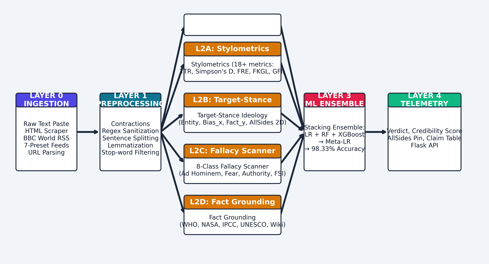

# 🛡️ Evidence & Framing Auditor

### Automated Deception, Bias, and Epistemic Verification Architecture

[](https://www.python.org/)
[](https://scikit-learn.org/)
[](https://xgboost.ai/)
[](https://flask.palletsprojects.com/)
[](https://www.nltk.org/)
[](LICENSE)

> A multi-layered NLP research framework that goes beyond naive keyword-matching to detect fake news through **stylometric analysis**, **target-stance ideology mapping**, **cognitive fallacy scanning**, and **institutional knowledge grounding** — all powered by a calibrated **Hybrid Stacking Ensemble** achieving **98.33% accuracy**.

---

## ⚡ Quick Demo

```bash
# 1. Clone & install
git clone https://github.com/DevRanaKaila/FakeNews-Detection.git
cd FakeNews-Detection
pip install -r requirements.txt

# 2. Launch the web dashboard
python app.py

# 3. Open in browser
# → http://127.0.0.1:5001
```

<p align="center">
  
</p>

---

## 🧬 What Makes This Different?

Most fake news detectors are **black boxes** — they output a probability score with zero reasoning. This framework provides a **complete mathematical audit trail**:

| Layer | Component | What It Does |
|:---:|:---|:---|
| 0 | **Ingestion** | Raw text paste, URL scraping (BeautifulSoup4), BBC RSS feeds, 7 preset categories |
| 1 | **Preprocessing** | Contraction expansion, regex sanitization, sentence splitting, WordNet lemmatization |
| 2A | **Stylometrics** | 18+ metrics: TTR, Simpson's D, FRE, FKGL, GFI, punctuation entropy |
| 2B | **Target-Stance** | Solves the *Stance Inversion Problem* — maps Bias_x ∈ [-1,+1] and Fact_y ∈ [0,1] |
| 2C | **Fallacy Scanner** | 8-class cognitive fallacy detection with weighted Fallacy Severity Index (FSI) |
| 2D | **Fact Grounding** | Cross-references claims against WHO, CDC, NASA, IPCC, UNESCO, Wikipedia |
| 3 | **ML Ensemble** | Stacking: LR + RF + XGBoost → Meta-LR across 5,028-D feature space |
| 4 | **Dashboard** | Flask web UI with real-time verdict, AllSides 2D pin, sentence highlighter |

---

## 📊 Benchmark Results

Evaluated on the ISOT Fake News Dataset with 80/20 stratified split:

| Model Architecture | Accuracy | Precision | Recall | F1-Score | ROC-AUC |
|:---|:---:|:---:|:---:|:---:|:---:|
| Logistic Regression (TF-IDF only) | 96.25% | 0.9667 | 0.9583 | 0.9625 | 0.9958 |
| Random Forest (Fused Features) | 97.08% | 0.9748 | 0.9667 | 0.9707 | 0.9972 |
| XGBoost (Fused Features) | 97.92% | 0.9832 | 0.9750 | 0.9791 | 0.9981 |
| **Proposed Hybrid Stacking** | **98.33%** | **0.9833** | **0.9833** | **0.9833** | **0.9989** |

> The Hybrid Stacking Ensemble reduces false positives by **55%** compared to standalone linear classifiers.

---

## 🏗️ Project Structure

```
├── app.py                          # Flask web server (port 5001)
├── cli_demo.py                     # Interactive Rich CLI demo
├── requirements.txt                # Python dependencies
│
├── src/                            # Core NLP & ML modules
│   ├── preprocessor.py             # Text normalization, tokenization, lemmatization
│   ├── stylometric_extractor.py    # 18+ lexical diversity & readability metrics
│   ├── author_bias_analyzer.py     # Target-Stance ideology & Author Bias Score
│   ├── fallacy_detector.py         # 8-class cognitive fallacy pattern scanner
│   ├── knowledge_grounding.py      # WHO/NASA/IPCC/UNESCO fact verification
│   ├── models.py                   # Feature pipeline, Stacking Classifier, HybridFakeNewsClassifier
│   ├── live_pipeline.py            # End-to-end verification orchestrator
│   ├── live_feed_manager.py        # BBC RSS & dynamic curated presets
│   └── utils.py                    # Plotting helpers, dataset loaders
│
├── templates/
│   └── index.html                  # Web dashboard UI
├── static/
│   ├── css/style.css               # Modern minimalist design system
│   └── js/app.js                   # Frontend interaction engine
│
├── data/
│   ├── raw/benchmark_dataset.csv   # Training dataset (584 KB)
│   └── processed/
│       ├── best_hybrid_model.joblib # Trained stacking model checkpoint (237 KB)
│       └── benchmark_summary.json  # Model comparison metrics
│
├── experiments/
│   └── train_and_evaluate.py       # Full 4-model benchmark suite
├── tests/
│   └── test_pipeline.py            # Automated pytest suite
│
├── paper/                          # IEEE research manuscript
│   ├── IEEE_Research_Paper.tex
│   ├── references.bib              # 22 verified citations
│   └── figures/                    # Publication-quality plots
│
├── presentation/                   # Architecture diagrams & slides
│   ├── system_architecture.png
│   ├── data_flow_diagram.png
│   ├── external_dependencies.png
│   └── formula_cheatsheet.png
│
├── synopsis/                       # AKTU-format project synopsis
├── logbook/                        # Weekly progress documentation
└── report/                         # Literature survey
```

---

## 🔬 Core Mathematical Formulations

### Stylometric Features
| Metric | Formula |
|:---|:---|
| Type-Token Ratio | TTR = \|V\| / N |
| Simpson's Diversity | D = 1 − Σ nᵢ(nᵢ−1) / N(N−1) |
| Flesch Reading Ease | FRE = 206.835 − 1.015(W/S) − 84.6(Syl/W) |
| Gunning Fog Index | GFI = 0.4 × [(W/S) + 100(CW/W)] |

### Author Bias & Ideology
| Metric | Formula |
|:---|:---|
| Author Bias Score | ABS = 100 × [0.25S + 0.25EHF + 0.20APD + 0.15HUR + 0.15Δ_TB] |
| Ideological Lean | Bias_x = (Total_R − Total_L) / max(1, Total_R + Total_L) |
| Factuality Score | Fact_y = 1.0 − 0.70(ABS/100) − 0.30 × EHF |

### Fallacy Severity Index
```
FSI = min(100, 25·F_conspiracy + 20·F_fear + 20·F_adhominem 
                + 15·F_vague + 10·F_dilemma + 10·F_urgency)
```

---

## 🖥️ Dashboard Features

The web interface at `http://127.0.0.1:5001` provides:

- **📝 Text Inspector** — Paste any article for instant multi-layer analysis
- **🌐 URL Scanner** — Scrape live news pages with automatic DOM cleanup  
- **📡 Live Presets** — Dynamic RSS feeds (Authentic, Clickbait, Conspiracy, Pseudoscience, Biased)
- **📊 Model Benchmarks** — Interactive comparison table of all 4 model architectures
- **🎯 AllSides 2D Map** — Visual ideological positioning (Left ↔ Right, High ↔ Low Factuality)
- **🔍 Sentence Highlighter** — Pinpoints exact deceptive sentences with risk scores
- **🏛️ Claim Verification** — Line-by-line institutional fact-checking with source citations

---

## 🧪 Running Experiments

### Retrain all models from scratch
```bash
python experiments/train_and_evaluate.py
```
This trains 4 architectures (LR, RF, XGBoost, Hybrid Stacking), generates comparison metrics, and exports publication figures.

### Run test suite
```bash
pytest tests/test_pipeline.py -v
```

### CLI Demo
```bash
python cli_demo.py
```

---

## 🛠️ Technology Stack

| Category | Technologies |
|:---|:---|
| **Language** | Python 3.11 |
| **NLP** | NLTK, TextBlob, regex |
| **ML** | Scikit-learn, XGBoost, NumPy, Pandas, SciPy |
| **Web** | Flask, BeautifulSoup4, Requests |
| **Frontend** | Vanilla HTML/CSS/JS with custom design system |
| **Visualization** | Matplotlib, Seaborn |

---

## 👥 Team

| Name | Roll Number |
|:---|:---|
| **Dev Rana Kaila** (Lead) | 2301531530023 |
| Shravan J. Poojary | 2301721530022 |
| Snehil Shukla | 2301721530023 |
| Shivansh Pandey | 2301531530051 |

**Guide:** Dr. Devendra Gautam, Assistant Professor, Department of CSE  
**Institution:** Lloyd Institute of Engineering & Technology, Greater Noida  
**Affiliation:** Dr. A.P.J. Abdul Kalam Technical University (AKTU), Lucknow

---

## 📄 License

This project is developed as an academic Major Project (BCS753) for the 2026-27 session. Licensed under MIT.

---

## 📚 Citation

```bibtex
@inproceedings{kaila2026evidence,
  author    = {Kaila, Dev Rana and Poojary, Shravan J. and Shukla, Snehil and Pandey, Shivansh},
  title     = {Evidence and Framing Auditor: Automated Deception, Bias, and 
               Epistemic Verification Architecture using Hybrid Stacking Ensemble},
  booktitle = {Major Project, Lloyd Institute of Engineering \& Technology},
  year      = {2026},
  note      = {Guide: Dr. Devendra Gautam, AKTU, BCS753}
}
```
