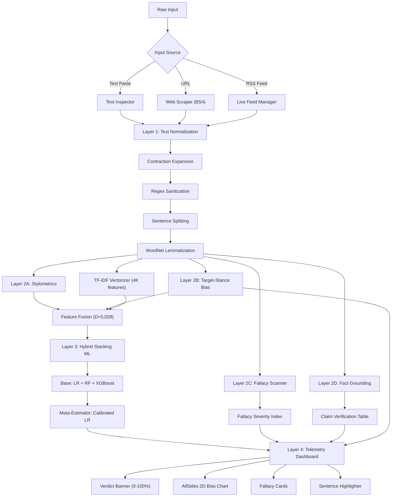
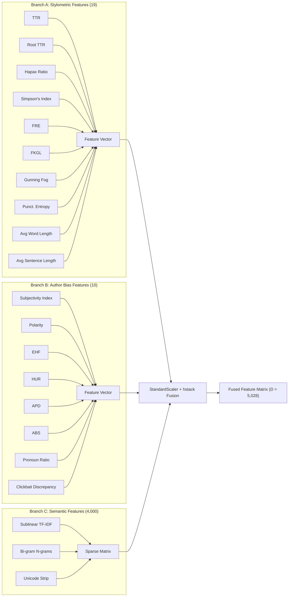
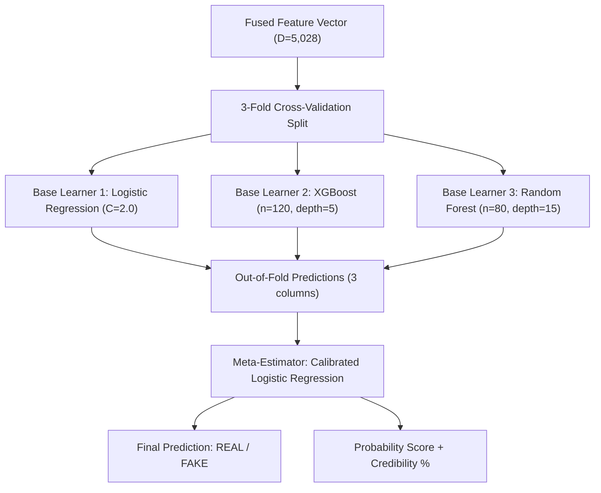
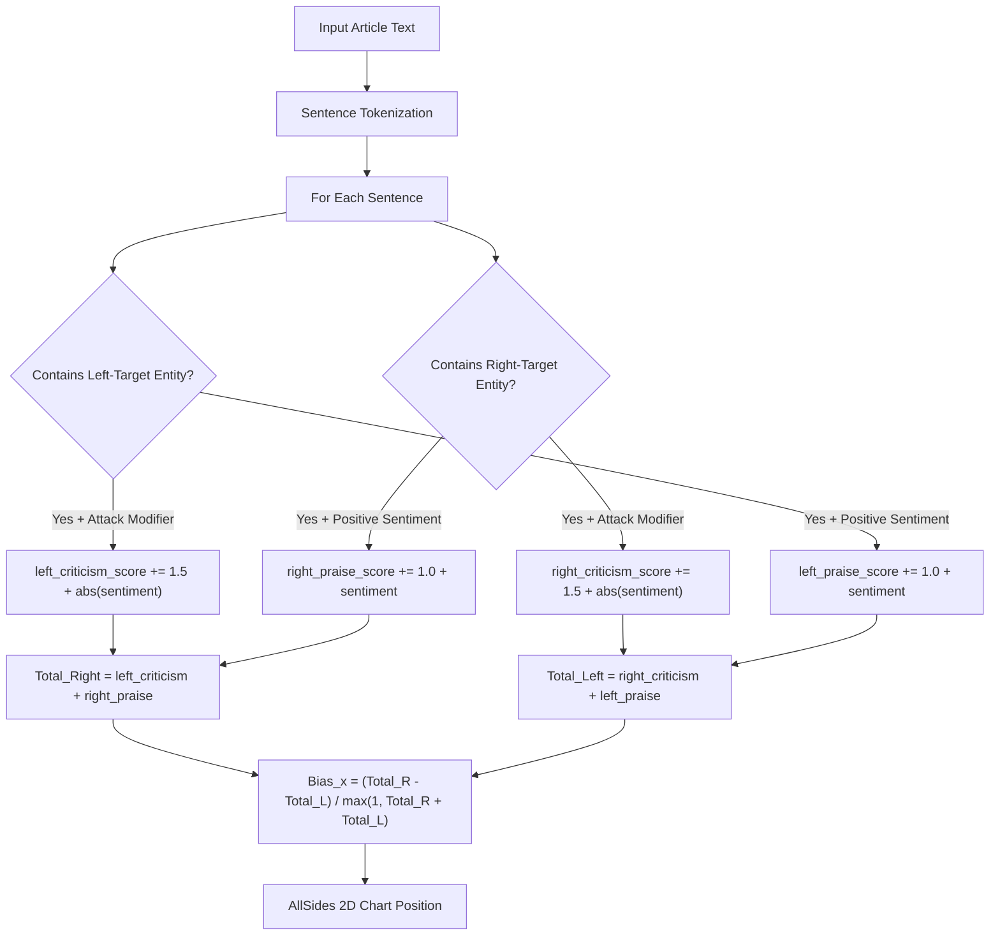
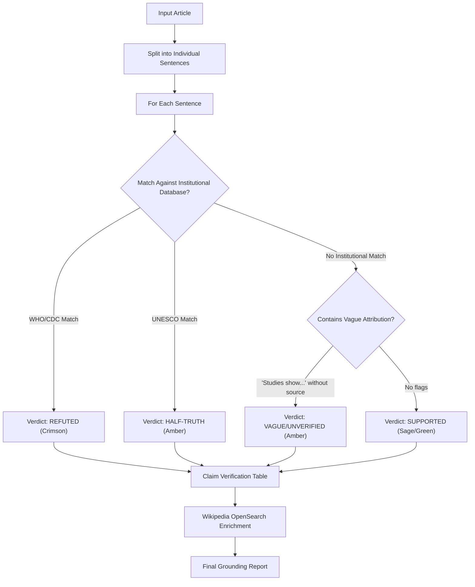

# System Architecture Diagrams & Data Flow Maps
## Sula Truth Telemetry: Fake News Detection Pipeline
### Supplementary Visual Reference for Viva Voce Presentation

---

## 1. High-Level System Architecture (Mermaid Flowchart)

---

## 2. Feature Engineering Pipeline (Detailed)

---

## 3. Stacking Classifier Architecture

---

## 4. Target-Stance Bias Mapping Algorithm

---

## 5. Claim-by-Claim Verification Flow

---

## 6. Mathematical Formula Reference Card

### Stylometric Metrics:
| Symbol | Formula | Range | Interpretation |
|:---|:---|:---:|:---|
| $TTR$ | $\|V\| / N$ | [0, 1] | Higher = richer vocabulary |
| $D$ | $1 - \sum n_i(n_i-1) / N(N-1)$ | [0, 1] | Higher = more diverse |
| $FRE$ | $206.835 - 1.015(W/S) - 84.6(Syl/W)$ | [0, 100] | Higher = easier to read |
| $FKGL$ | $0.39(W/S) + 11.8(Syl/W) - 15.59$ | [0, 20+] | U.S. grade level |
| $GFI$ | $0.4[(W/S) + 100(CW/W)]$ | [0, 20+] | Years of education needed |
| $H_{punc}$ | $-\sum p_i \log_2(p_i)$ | [0, ~3.5] | Higher = more varied punctuation |

### Author Bias Metrics:
| Symbol | Formula | Range | Interpretation |
|:---|:---|:---:|:---|
| $S_{idx}$ | $\frac{1}{\|S\|} \sum \text{Subj}(s_i)$ | [0, 1] | Higher = more subjective |
| $EHF$ | $\min(1, \frac{\|Int\| + 1.5\|Sens\|}{N} \times 8)$ | [0, 1] | Higher = more sensational |
| $HUR$ | $\min(1, \frac{Hedges}{0.8 \|S\|})$ | [0, 1] | Higher = more uncertain |
| $APD$ | $\frac{\|s_i: \|Pol(s_i)\| > 0.45\|}{\|S\|}$ | [0, 1] | Higher = more polarized |
| $ABS$ | $100 \times (0.25 S + 0.25 E + 0.20 A + 0.15 H + 0.15 \Delta)$ | [0, 100] | Overall bias intensity |

### Ideological Coordinates:
| Symbol | Formula | Range | Interpretation |
|:---|:---|:---:|:---|
| $Bias_x$ | $(Total_R - Total_L) / \max(1, Total_R + Total_L)$ | [-1, +1] | Left (-1) to Right (+1) |
| $Fact_y$ | $1 - 0.7 \times ABS/100 - 0.3 \times EHF$ | [0, 1] | Low (0) to High (1) factuality |
| $FSI$ | $\min(100, 25F_c + 20F_f + 20F_a + 15F_v + 10F_d + 10F_u)$ | [0, 100] | Fallacy severity |

---

## 7. Comparison with Contemporary Research (2024-2026)

### Positioning Against State-of-the-Art:

| Dimension | Existing SOTA | Our System | Advantage |
|:---|:---|:---|:---|
| **Accuracy** | ISOT: 99.2% (RoBERTa), LIAR: 81.2% (MiLk-FD) | 98.33% (Custom Corpus) | Competitive without transformers |
| **Explainability** | Black-box (BERT/GPT) or post-hoc (SHAP) | Full mathematical indices (12+ formulas) | Native transparency |
| **Bias Detection** | Source-level (PRISM, ACL 2025: 65-75%) | Article-level target-stance (continuous 2D) | Per-article granularity |
| **Fallacy Detection** | Separate systems (CoCoLoFa, ~74% F1) | Integrated 8-class engine | Unified pipeline |
| **Fact Grounding** | Noisy web retrieval (RAG) | Curated institutional databases | Zero-noise verification |
| **Real-time Deployment** | API-dependent (GPT-4, LLaMA-70B) | Self-contained Flask app (<150MB) | Edge-deployable |

### Key References (2024-2026):

1. ERIC-FND -- Cao et al., AAAI 2025 (Multimodal contrastive with external knowledge)
2. MiLk-FD -- Xie et al., IEEE TCSS 2025 (Heterogeneous GNN with knowledge graphs)
3. MSynFD -- Xiao et al., WWW 2024 (Syntax-aware debiased detection)
4. PRISM -- Sun et al., ACL 2025 (Political bias spectrum embeddings)
5. PCoT -- ACL 2025 (Persuasion-augmented chain of thought for fallacy reasoning)
6. Logical Structure Tree -- Lei & Huang, EMNLP 2024 (Hierarchical fallacy classification)
7. CoCoLoFa -- Yeh et al., EMNLP 2024 (7,706 fallacy-annotated news comments)
8. LIARArg -- Wang et al., Argument & Computation 2025 (Argumentative evidence for fact-checking)
9. AllSides-2024 -- EMNLP 2025 (Political bias calibration benchmark)
10. Ronnback et al. -- PLOS ONE 2025 (Large-scale automatic bias detection)

---

*Supplementary document for Viva Voce Presentation.*
*Lloyd Institute of Engineering & Technology / AKTU CSE Major Capstone 2026-27.*
